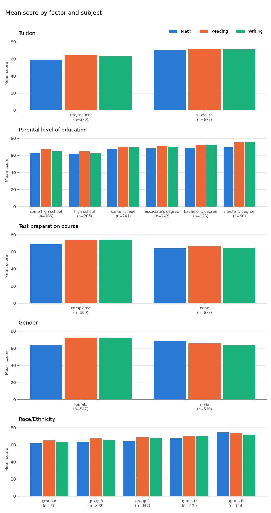
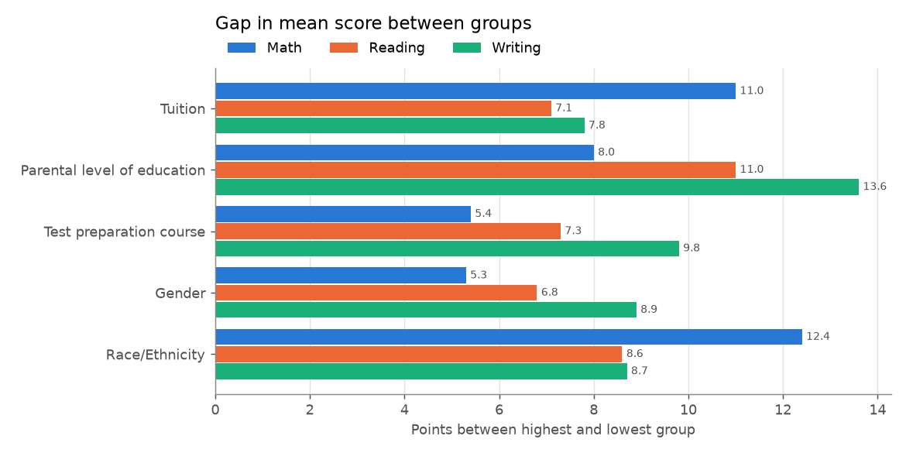
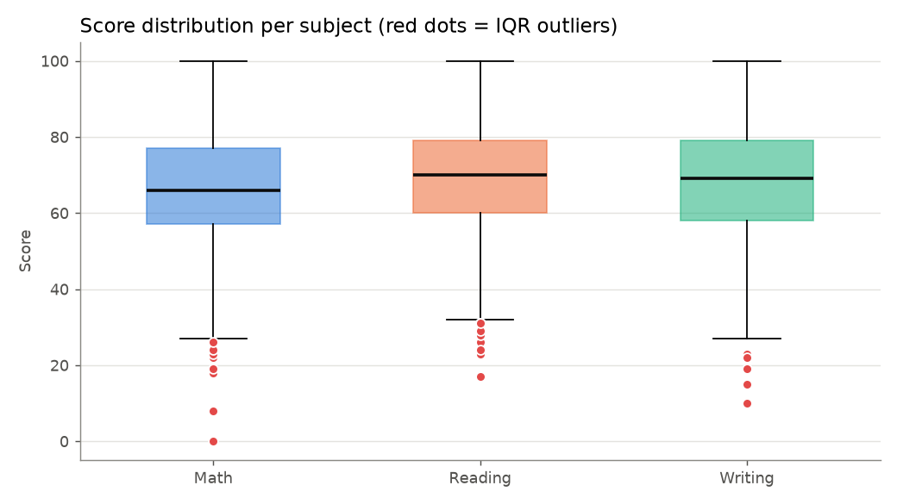

# דוח חקר נתונים – ציוני תלמידים

נכתב על ידי: **יואב** – סוכן חקר הנתונים
קובץ: `outputs/Student_tests_results_clean.csv` (הקובץ הנקי, קריאה בלבד – לא שונה)
קוד: `scripts/explore_students.py` | גרפים: `outputs/figures/`

**הערה חשובה:** החקר מראה **קשרים** בין גורמים לציונים, לא סיבה ותוצאה. כדי לבדוק אם ההבדלים מובהקים צריך מבחן סטטיסטי (שלב 7).

---

## 1. הבנת הנתונים

- **1,057 תלמידים**, 8 עמודות, **אין ערכים חסרים**.
- 5 עמודות קטגוריאליות (הגורמים) + 3 עמודות ציונים (מספרים שלמים 0–100).
- אין עמודות תאריך, אין מידע גאוגרפי, אין מזהה תלמיד.

### כמה תלמידים בכל קבוצה

| גורם | קבוצה | n | % |
|---|---|---|---|
| **מלגה (Tuition)** | standard (ללא מלגה) | 678 | 64.1 |
| | free/reduced (מלגה) | 379 | 35.9 |
| **השכלת הורים** | some high school | 186 | 17.6 |
| | high school | 205 | 19.4 |
| | some college | 241 | 22.8 |
| | associate's degree | 242 | 22.9 |
| | bachelor's degree | 123 | 11.6 |
| | master's degree | 60 | 5.7 |
| **קורס הכנה** | none | 677 | 64.0 |
| | completed | 380 | 36.0 |
| **מגדר** | female | 547 | 51.8 |
| | male | 510 | 48.2 |
| **מוצא** | group A | 93 | 8.8 |
| | group B | 200 | 18.9 |
| | group C | 341 | 32.3 |
| | group D | 279 | 26.4 |
| | group E | 144 | 13.6 |

**מגבלה:** הקבוצות הקטנות (master's degree – 60, group A – 93) פחות יציבות; ממוצע שלהן יכול להשתנות יותר בגלל כמה תלמידים בודדים.

### השפעת הכפילויות
- ללא 68 הכפילויות נשארים 989 תלמידים.
- הממוצע הכללי משתנה בפחות מ־0.1 נקודה בכל מקצוע, והפערים בין הקבוצות משתנים בעד 0.4 נקודה.
- **מסקנה: הכפילויות לא משפיעות על הממצאים.** (כל כפילות מופיעה בדיוק פעמיים – אין שורה שמופיעה 3 פעמים ומעלה.)

---

## 2. דפוסים וקשרים

### ממוצע ציון לפי גורם ולפי מקצוע

| גורם | קבוצה | מתמטיקה | קריאה | כתיבה |
|---|---|---|---|---|
| מלגה | free/reduced | 59.1 | 64.7 | 63.1 |
| | standard | 70.1 | 71.8 | 70.9 |
| השכלת הורים | some high school | 63.4 | 67.0 | 64.9 |
| | high school | 61.9 | 64.6 | 62.3 |
| | some college | 67.4 | 69.8 | 69.2 |
| | associate's degree | 68.3 | 71.3 | 70.1 |
| | bachelor's degree | 68.9 | 72.3 | 72.7 |
| | master's degree | 69.9 | 75.6 | 75.9 |
| קורס הכנה | completed | 69.6 | 73.9 | 74.4 |
| | none | 64.2 | 66.6 | 64.6 |
| מגדר | female | 63.6 | 72.5 | 72.4 |
| | male | 68.9 | 65.7 | 63.5 |
| מוצא | group A | 62.0 | 65.1 | 63.2 |
| | group B | 63.5 | 67.3 | 65.5 |
| | group C | 64.4 | 69.1 | 67.8 |
| | group D | 67.3 | 70.0 | 70.0 |
| | group E | 74.4 | 73.7 | 71.9 |

### הפער בין הקבוצה הגבוהה לנמוכה (בנקודות)

| גורם | מתמטיקה | קריאה | כתיבה |
|---|---|---|---|
| מלגה | **11.0** | 7.1 | 7.8 |
| השכלת הורים | 8.0 | 11.0 | **13.6** |
| קורס הכנה | 5.4 | 7.3 | 9.8 |
| מגדר | 5.3 (בנים) | 6.8 (בנות) | 8.9 (בנות) |
| מוצא | **12.4** | 8.6 | 8.7 |

### מה רואים
- **לכל חמשת הגורמים יש קשר לציונים**, אבל בעוצמה שונה בכל מקצוע.
- **מתמטיקה:** הפערים הגדולים ביותר הם לפי **מלגה** ו**מוצא**.
- **קריאה וכתיבה:** הפער הגדול ביותר הוא לפי **השכלת הורים**.
- **מגדר הוא הגורם היחיד שהכיוון שלו מתהפך:** בנים גבוהים יותר במתמטיקה, בנות גבוהות יותר בקריאה ובכתיבה.
- **השכלת הורים:** ככל שההשכלה עולה, הציונים עולים – עם חריגה אחת: "high school" נמוך מעט מ־"some high school".
- **מוצא:** הציונים עולים באופן עקבי מ־group A ועד group E (אין לנו מידע מה כל קבוצה מייצגת).
- **הקשר בין המקצועות חזק:** קריאה–כתיבה 0.95, מתמטיקה–קריאה 0.82, מתמטיקה–כתיבה 0.80. תלמיד שחלש במקצוע אחד נוטה להיות חלש גם באחרים.

---

## 3. חריגים (לפי IQR)

| מקצוע | טווח | גבול תחתון לחריג | מספר חריגים | הציונים החריגים |
|---|---|---|---|---|
| מתמטיקה | 0–100 | 27 | 8 | 0, 8, 18, 19, 22, 23, 24, 26 |
| קריאה | 17–100 | 31.5 | 10 | 17, 23, 24, 24, 26, 28, 29, 29, 31, 31 |
| כתיבה | 10–100 | 26.5 | 5 | 10, 15, 19, 22, 23 |

- **כל החריגים הם בצד הנמוך**; אין חריגים כלפי מעלה.
- הם בטווח 0–100 ולכן **ייתכן שהם אמיתיים** – לא נמחקו (תפקיד החקר הוא רק להציג אותם).
- **52 תלמידים** קיבלו ציון מתחת ל־40 במקצוע אחד לפחות. מתוכם:
  - **77% עם מלגה** (לעומת 36% מכלל התלמידים).
  - **85% לא עשו קורס הכנה** (לעומת 64% מכלל התלמידים).

---

## 4. מסקנות ראשוניות

1. **תלמידים עם מלגה (free/reduced) מקבלים ציונים נמוכים יותר בכל שלושת המקצועות**, והפער הגדול ביותר הוא במתמטיקה (11 נקודות). הם גם מהווים את רוב התלמידים עם הציונים הנמוכים ביותר (77% מהתלמידים שקיבלו מתחת ל־40).
2. **הגורמים קשורים בצורה שונה לכל מקצוע:** מגדר מתהפך בין מתמטיקה (בנים) לקריאה וכתיבה (בנות), והשכלת הורים וקורס הכנה קשורים יותר לכתיבה מאשר למתמטיקה.

נקודה נוספת: **השלמת קורס הכנה קשורה לציונים גבוהים יותר בכל המקצועות** (5–10 נקודות), והיא הגורם היחיד מבין החמישה שבית הספר יכול לשנות.

**מגבלות:** זהו קשר בלבד – ייתכן שהגורמים קשורים זה לזה (למשל, תלמידים עם מלגה אולי עושים פחות קורס הכנה), ולכן אי אפשר עדיין לדעת איזה גורם "אחראי" להבדל. עוד לא נבדק אם ההבדלים מובהקים סטטיסטית.

---

## 5. שאלות להמשך

1. **האם ההבדלים מובהקים סטטיסטית** או שהם יכולים לנבוע ממקרה? (מבחן סטטיסטי – שלב 7)
2. **האם הגורמים קשורים זה לזה?** למשל, האם תלמידים עם מלגה עושים פחות קורס הכנה? אם כן – מה מהם קשור יותר לציון?
3. **האם קורס ההכנה עוזר לתלמידים עם מלגה באותה מידה** כמו לתלמידים בלי מלגה?
4. **איזה שילוב של גורמים מאפיין את התלמידים בסיכון** (ציון מתחת ל־40, או מתחת לסף אחר שתגדיר)?
5. **למה "high school" נמוך מ־"some high school"?** האם זה הבדל אמיתי או מקרי?
